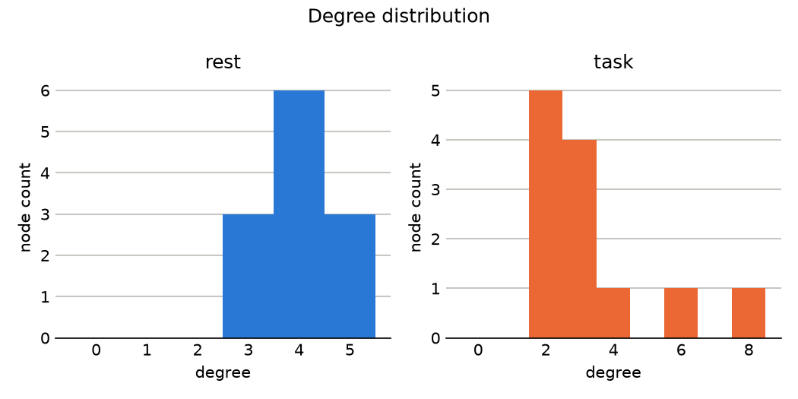

# Network Analysis Report

- Domain: network
- Domain description: Network-science analysis of graph-structured data, focused on small-world structure, community organization, and connectivity.
- Analysis question: Does the network show small-world organization, distinct community structure, or scale-free connectivity, and how does that structure shift between conditions?
- Data source: network_example.csv
- Edge columns: source, target, weight
- Condition column: condition
- Directed: False

## Domain edge roles
- source: One endpoint of each edge (a node identifier).
- target: The other endpoint of each edge (a node identifier).
- weight: Optional edge weight; used for clustering and modularity, but not for shortest-path distance.
- condition: Experimental or task condition used to compare network structure across states.

## Data provenance
- Input rows: 44
- Duplicate rows detected (not removed automatically): 0
- Rows dropped for missing values in ['source', 'target', 'condition']: 0
- Rows analyzed: 44

## Network metrics
```
condition  n_nodes  n_edges  density  mean_degree  avg_clustering  transitivity  modularity  avg_shortest_path_length  n_connected_components
     rest       12       24 0.363636     4.000000        0.305556      0.320000     0.19184                  1.787879                       1
     task       12       20 0.303030     3.333333        0.350595      0.227273     0.20875                  1.803030                       1
```

## Visualizations


## Interpretation

Guiding question: Does the network show small-world organization, distinct community structure, or scale-free connectivity, and how does that structure shift between conditions?

- density: Density is the fraction of all possible edges that are actually present; sparse, structured networks with high clustering are more consistent with small-world or scale-free organization than with a dense, unstructured network (Barabási & Albert, 1999).
- mean_degree: A network dominated by a few very high-degree hub nodes rather than a roughly uniform degree is the signature of scale-free, preferential-attachment growth (Barabási & Albert, 1999) rather than a random or regular network; this summary reports the mean only, so check the degree-distribution plot for whether a few hubs dominate.
- avg_clustering: High average clustering means a node's neighbors tend to also be connected to each other, forming locally dense neighborhoods; this is one of the two defining ingredients of small-world structure (Watts & Strogatz, 1998).
- transitivity: Transitivity is the network-wide version of clustering (the fraction of connected triples that close into a triangle); comparing it against average clustering shows whether local density is spread evenly or concentrated in a few well-connected nodes (Newman, 2010).
- modularity: High modularity indicates the network decomposes into distinct communities with denser connections inside each community than between them (Newman, 2010), consistent with functional specialization or subgroup structure; low modularity suggests a more globally integrated network without clear subgroup boundaries.
- avg_shortest_path_length: A short average path length despite high clustering is the hallmark of small-world structure (Watts & Strogatz, 1998), combining locally dense neighborhoods with efficient global reach. A short path length alongside low clustering instead suggests a more random or centralized structure rather than a small-world one.

- density is lower in task than in rest. Density is the fraction of all possible edges that are actually present; sparse, structured networks with high clustering are more consistent with small-world or scale-free organization than with a dense, unstructured network (Barabási & Albert, 1999).
- mean degree is lower in task than in rest. A network dominated by a few very high-degree hub nodes rather than a roughly uniform degree is the signature of scale-free, preferential-attachment growth (Barabási & Albert, 1999) rather than a random or regular network; this summary reports the mean only, so check the degree-distribution plot for whether a few hubs dominate.
- avg clustering is higher in task than in rest. High average clustering means a node's neighbors tend to also be connected to each other, forming locally dense neighborhoods; this is one of the two defining ingredients of small-world structure (Watts & Strogatz, 1998).
- transitivity is lower in task than in rest. Transitivity is the network-wide version of clustering (the fraction of connected triples that close into a triangle); comparing it against average clustering shows whether local density is spread evenly or concentrated in a few well-connected nodes (Newman, 2010).
- modularity is higher in task than in rest. High modularity indicates the network decomposes into distinct communities with denser connections inside each community than between them (Newman, 2010), consistent with functional specialization or subgroup structure; low modularity suggests a more globally integrated network without clear subgroup boundaries.
- avg shortest path length is higher in task than in rest. A short average path length despite high clustering is the hallmark of small-world structure (Watts & Strogatz, 1998), combining locally dense neighborhoods with efficient global reach. A short path length alongside low clustering instead suggests a more random or centralized structure rather than a small-world one.