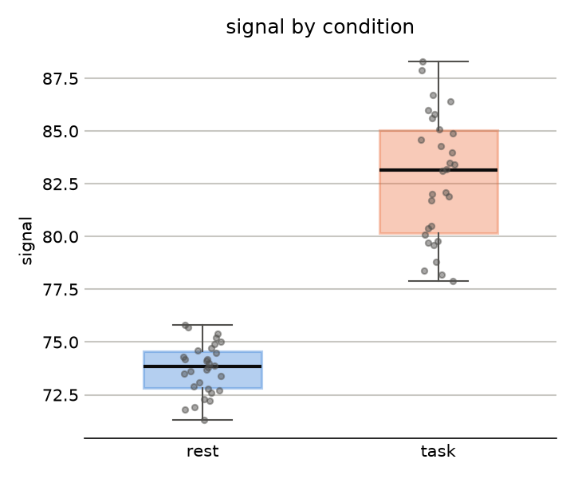
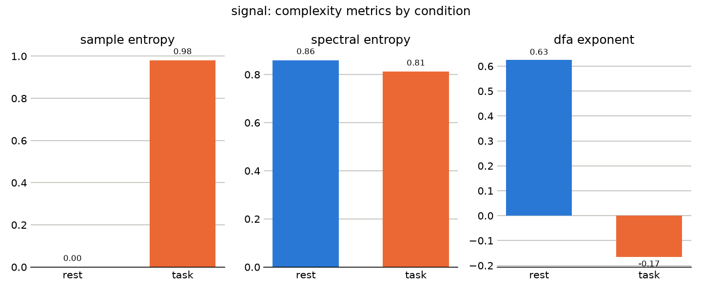

# Complexity Analysis Report
- Domain: attention
- Domain description: Cognitive attention profile for task-driven dynamics and adaptive control.
- Analysis question: Does the monitored signal show tighter predictive precision when attention is engaged by the task, or reduced top-down control?
- Data source: physio_example.csv
- Signal columns: signal
- Condition column: condition
## Domain signal roles
- primary_signal: Main cognitive or neural signal associated with attentional state.
- condition: Task phase, condition, or experimental state used for comparison.
- covariate: Optional trial-level, session-level, or participant metadata.
Note: the 'attention' domain profile expects columns [signal, condition, trial]; missing from this dataset: trial.
## Condition summary
condition  mean_signal  std_signal  min_signal  max_signal  median signal
     rest    73.736667    1.192356        71.3        75.8   73.85 signal
     task    82.796667    2.994879        77.9        88.3   83.15 signal
## Complexity metrics
condition signal  n_samples      mean      std  min  max  variance  sample_entropy  spectral_entropy  dfa_exponent
     rest signal         30 73.736667 1.192356 71.3 75.8  1.421713        0.000000          0.859540      0.625685
     task signal         30 82.796667 2.994879 77.9 88.3  8.969299        0.980829          0.812203     -0.166528
## Statistical significance
signal condition_a condition_b  n_a  n_b    mean_a    mean_b  t_statistic      p_value  cohens_d
signal        rest        task   30   30 73.736667 82.796667   -15.394299 6.556483e-18 -3.974791
## Visualizations

## Interpretation
Guiding question: Does the monitored signal show tighter predictive precision when attention is engaged by the task, or reduced top-down control?
Methodological note: entropy-based metrics quantify unpredictability, not complexity in the fuller sense used in complexity science (Crutchfield & Young, 1989; Gell-Mann & Lloyd, 1996). A maximally random signal has high entropy but little structured organization, so read the entropy changes below as changes in signal regularity, not as a direct verdict on how "complex" the underlying system is.
Welch's t-test checks whether the raw signal's mean level differs between two conditions beyond what sampling variability alone would produce; Cohen's d expresses the size of that difference in standard-deviation units (roughly: ~0.2 small, ~0.5 medium, ~0.8 large). This tests the raw signal, not the complexity metrics above, which are single summary values per condition rather than per-sample distributions.
- sample_entropy: Attention can be framed as precision-weighting of expected sensory or task-relevant signals (Friston, 2010; Clark, 2013; Hohwy, 2013); reduced entropy when attention is engaged is consistent with tighter predictive precision around the task, while elevated entropy may reflect divided attention or reduced top-down control rather than richer processing.
- spectral_entropy: A shift toward broader frequency engagement when attention is recruited is consistent with multiple task-relevant processes being active concurrently (Rumelhart et al., 1986); a narrower spectrum can indicate a single dominant rhythm capturing the bulk of signal energy.
- dfa_exponent: Changes in long-range temporal correlation during attentional engagement point to shifts in how strongly past states constrain present ones (Hopfield, 1982); stronger persistence is consistent with sustained, attractor-like engagement, while a drop toward random-walk-like behavior (~0.5) suggests more moment-to-moment reactivity.
- sample entropy is higher in task than in rest. Attention can be framed as precision-weighting of expected sensory or task-relevant signals (Friston, 2010; Clark, 2013; Hohwy, 2013); reduced entropy when attention is engaged is consistent with tighter predictive precision around the task, while elevated entropy may reflect divided attention or reduced top-down control rather than richer processing.
- spectral entropy is lower in task than in rest. A shift toward broader frequency engagement when attention is recruited is consistent with multiple task-relevant processes being active concurrently (Rumelhart et al., 1986); a narrower spectrum can indicate a single dominant rhythm capturing the bulk of signal energy.
- dfa exponent is lower in task than in rest. Changes in long-range temporal correlation during attentional engagement point to shifts in how strongly past states constrain present ones (Hopfield, 1982); stronger persistence is consistent with sustained, attractor-like engagement, while a drop toward random-walk-like behavior (~0.5) suggests more moment-to-moment reactivity.
- Raw signal differs significantly between rest and task (Welch's t-test p<0.001, Cohen's d=-3.97).